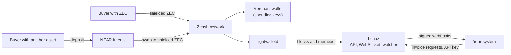
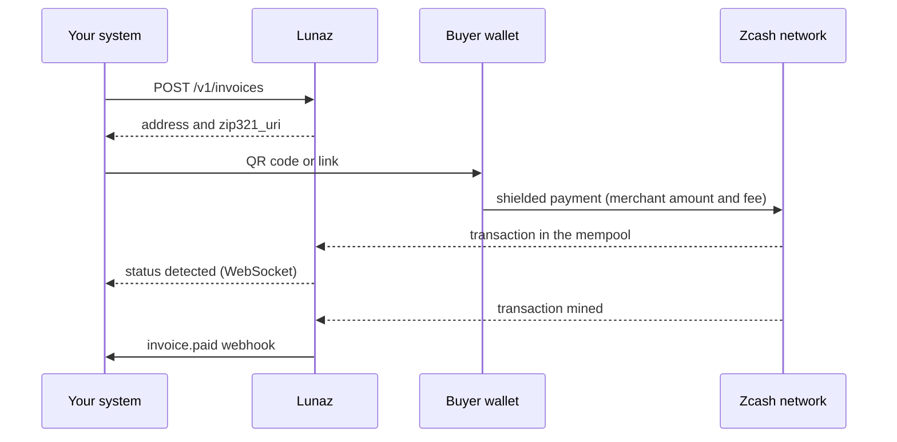

Lunaz sits between your system and the Zcash network. It creates invoices, watches the chain for payments and tells your system when an invoice is paid.

## Architecture

## One address per invoice

Lunaz derives each invoice address from your incoming viewing key (UIVK). The address is a diversified Orchard address. The diversifier index starts at 2^80, so an invoice address never collides with an address that you use elsewhere.

Each invoice has its own address. Nothing on chain links two invoices to each other or to you.

You set the viewing key once per account. If you paste a Unified Full Viewing Key (UFVK), Lunaz keeps only its incoming part. One viewing key cannot belong to two accounts.

## Detection by trial decryption

A watcher reads compact blocks from a lightwalletd server. It trial-decrypts the Orchard and Ironwood (NU6.3) actions with the viewing key of every merchant. A match means that the action pays one of that merchant's invoice addresses.

A second task does the same for the mempool. For this reason an invoice shows as `detected` in seconds, before the transaction is mined. After one confirmation the invoice is `paid`.

## Cross-chain payments

A buyer with another asset deposits it on the origin chain. NEAR Intents 1Click swaps the asset and sends shielded ZEC to the invoice address. The watcher sees that ZEC like any other payment.

Lunaz polls the swap status every 10 seconds. See [Accept other crypto](../../guides/accept-other-crypto/).

## Where the keys live

- Your backend holds an API key. The key can create invoices and nothing else.
- Keep your API key on your server. Never put it in browser code.
- The invoice ID works as the access token for the public endpoints: invoice status, WebSocket and swap. Treat the checkout link as a secret.
- Your wallet holds the spending keys. No Lunaz service has them.

## Payment flow

1. Your system creates an invoice with the API.
2. Lunaz returns a fresh shielded address and a ZIP-321 URI.
3. The buyer scans the QR code and pays.
4. The watcher sees the transaction in the mempool. The status becomes `detected`.
5. The transaction is mined. The status becomes `paid`.
6. Lunaz sends the `invoice.paid` webhook and closes the WebSocket.
